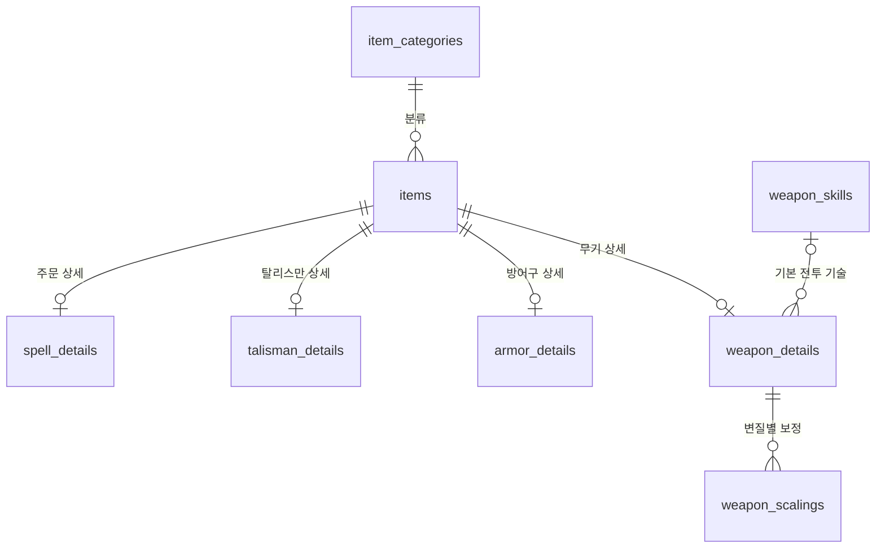

# 데이터베이스 설계

## 목적과 기준 자료

이 문서는 대화 세션이 바뀌어도 데이터 구조와 설계 결정을 확인하고, 조회·화면·데이터 등록 등 후속 기능을 일관되게 개발하기 위한 참조 문서입니다. 이전 대화 내용을 알고 있다고 가정하지 않습니다.

| 확인 대상 | 기준 자료 |
| ------------------------------- | ------------------------------------------------ |
| 테이블·컬럼·DB 제약·권한 | `supabase/migrations/*.sql`을 적용 순서대로 확인 |
| 개발 샘플의 실제 입력 값 | `supabase/seed.sql` |
| 로컬 서비스·시드 실행 설정 | `supabase/config.toml` |
| 설계 의도·값의 의미·미구현 범위 | 이 문서 |
| 특정 환경의 적용 여부·현재 행 | 해당 DB의 마이그레이션 이력과 실제 조회 |

문서와 SQL이 다르면 SQL로 구현 상태를 확인하고 차이를 명시합니다. 이 문서만으로 운영 반영 여부나 현재 데이터 전체를 판단하지 않습니다. 스키마·시드·설계 결정이 바뀌면 관련 설명과 예시도 함께 갱신합니다.

개발 환경은 Docker 로컬 Supabase, 운영 환경은 Supabase 클라우드로 분리합니다. 현재 마이그레이션과 시드 적용은 로컬에서 검증했습니다.

## 개발 전에 확인할 확정 규칙

- 공통 아이템 식별자는 `items.id`입니다. 이름에는 고유 제약이 없으므로 기능에서 이름을 식별자로 사용하지 않습니다.
- `type`은 무기·주문 등의 종류, `category_id`는 단검·마술 등의 세부 분류입니다. 두 종류가 일치해야 한다는 규칙은 복합 외래키로 보장합니다.
- 이미지·콘텐츠 소속·게임 내 설명은 공통 정보입니다. 일반 설명은 제외했습니다. 게임 내 원문과 사용자 해설을 같은 컬럼에 섞지 않습니다.
- `content_code`는 콘텐츠 소속이며 판매 에디션·현재 소유 여부·획득 장소를 뜻하지 않습니다.
- 무기는 기본 전투 기술을 참조합니다. 전회 아이템과 전투 기술을 동일한 데이터로 취급하지 않습니다. 사용자의 전회 장착 상태는 저장하지 않습니다.
- 공격력·가드 성능은 표준 변질(변질 불가 무기는 기본 상태)의 최대 강화 기준, 변질별 보정은 각 변질의 최대 강화 기준, 부가 효과는 미강화 기본 수치입니다. 공격력은 캐릭터 능력치로 더해지는 공격력과 일시적 버프를 제외한 무기 자체 수치이고, 부가 효과도 캐릭터 능력치 보정·일시적 버프를 제외합니다. 이들을 동일한 조건의 수치로 계산하지 않습니다.
- 강화 단계 컬럼은 의도적으로 제외했습니다. `weapon_scalings`의 변질 선택에 맞춰 `weapon_details`의 공격력이 바뀐다고 가정하지 않습니다.
- 수치의 `0`과 `NULL`, 보정 등급의 `-`와 `NULL`은 구분합니다. 미확인 값을 임의로 0이나 보정 없음으로 변환하지 않습니다.
- 공격 속성 배열은 출력 시 정렬합니다. 구체적인 표시 순서는 미확정이며 배열 저장 순서를 표시 규칙으로 삼지 않습니다.
- 모든 현재 테이블은 공개 조회용입니다. 로그인만으로 수정 권한이 생기지 않습니다. 쓰기·댓글·비공개 콘텐츠 기능은 별도 설계가 필요합니다.

## 테이블 관계



- 모든 획득 대상은 `items`에 저장하고, 종류별 정보는 상세 테이블로 분리합니다.
- 현재 상세 테이블은 무기·방어구·탈리스만·주문을 구현했습니다. `items` 행만 있고 무기 상세가 없는 상태도 허용합니다.
- 무기는 기본 전투 기술 하나를 선택적으로 참조합니다. 여러 무기가 같은 기술을 참조할 수 있습니다.
- 전회는 획득 아이템이고 전투 기술은 발동하는 기술입니다. 전회와 기술을 연결하는 상세 테이블은 아직 없습니다.
- 외래키는 모두 `ON UPDATE RESTRICT`, `ON DELETE RESTRICT`입니다. 참조 중인 키의 변경·삭제를 막으며 자동 연쇄 삭제는 하지 않습니다.

## 공통 종류: `item_type`

`items`, `item_categories`, `weapon_details`, `armor_details`에서 사용하는 PostgreSQL enum입니다.
이 문서의 코드 대응은 현재 스키마와 합의한 한국어 명칭을 기준으로 합니다. 모든 용어를 공식 현지화 자료와 별도 대조했다는 의미는 아닙니다.

| 값 | 의미 |
| ------------ | -------- |
| `weapon` | 무기 |
| `armor` | 방어구 |
| `talisman` | 탈리스만 |
| `ash_of_war` | 전회 |
| `spell` | 주문 |
| `gesture` | 제스처 |
| `spirit_ash` | 뼛가루 |

## `item_categories`: 세부 분류

직검·단검·투구처럼 각 종류 안의 세부 분류를 관리합니다. 분류는 실제 아이템을 입력할 때 추가할 수 있습니다.

| 컬럼 | 자료형 | NULL 허용 | 의미 |
| ------ | ----------- | --------- | ------------------------------------- |
| `id` | `bigint` | 아니요 | 자동 생성 기본키 |
| `name` | `text` | 아니요 | 분류명. 빈 문자열·공백만 있는 값 금지 |
| `type` | `item_type` | 아니요 | 분류가 속한 종류 |

- `(type, name)`은 고유합니다. 같은 종류에 같은 분류명을 중복 등록할 수 없습니다.
- `(id, type)` 고유 제약은 아이템에서 ID와 종류를 함께 참조하기 위해 사용합니다.

## `items`: 획득 대상의 공통 정보

| 컬럼 | 자료형 | NULL 허용 | 의미 |
| -------------------- | ----------- | --------- | ----------------------------------------------------------- |
| `id` | `bigint` | 아니요 | 자동 생성 기본키 |
| `name` | `text` | 아니요 | 아이템 이름. 빈 문자열·공백만 있는 값 금지 |
| `type` | `item_type` | 아니요 | 획득 대상의 종류 |
| `category_id` | `bigint` | 아니요 | 세부 분류 ID |
| `image_url` | `text` | 예 | 이미지 주소. URL 형식·접근 가능 여부는 DB에서 검증하지 않음 |
| `content_code` | `text` | 아니요 | 콘텐츠 소속. 아래 세 값만 허용하며 기본값 없음 |
| `game_description` | `text` | 예 | 게임 내 설명 원문 |
| `effect_description` | `text`      | 예        | 아이템 부가 효과의 표시용 설명                              |

| `content_code` | 의미 |
| ----------------------- | ------------------ |
| `base_game` | 본편 |
| `shadow_of_the_erdtree` | 황금 나무의 그림자 |
| `tarnished_pack` | 빛바랜자 에디션 |

`tarnished_pack`은 사용자 결정에 따라 서비스에서 '빛바랜자 에디션'으로 표시합니다. 이는 서비스 표시명이며, 저장 값은 추가 콘텐츠 팩(Tarnished Pack)을 뜻합니다.
콘텐츠 소속과 실제 획득 장소·진행 조건은 구분합니다. 여러 콘텐츠를 묶은 판매 상품인 Tarnished Edition은 별도 값으로 두지 않습니다.
일반 해설·사용자 설명은 현재 저장하지 않습니다.
부가 효과는 `effect_description`에 설명으로만 저장합니다. NULL은 효과 없음 또는 미입력이며 구분하지 않습니다. 효과별 필터·계산용 구조는 두지 않습니다. 무기의 출혈·동상 등 축적 수치는 기존 전용 컬럼을 유지합니다.

- `(category_id, type)`이 `item_categories(id, type)`을 참조합니다. 무기에 방어구 분류를 연결할 수 없습니다.
- `(id, type)`은 무기 상세의 복합 외래키를 위한 고유 제약입니다.
- 아이템 이름에는 고유 제약이 없습니다. 이름이 아닌 ID가 식별 기준입니다.
- `(category_id, type)` 인덱스가 있습니다.

## `weapon_skills`: 전투 기술

| 컬럼 | 자료형 | NULL 허용 | 의미 |
| -------------- | -------- | --------- | ------------------------------------------------------------------- |
| `id` | `bigint` | 아니요 | 자동 생성 기본키 |
| `name` | `text` | 아니요 | 기술 이름. 빈 문자열·공백만 있는 값 금지 |
| `description` | `text` | 예 | 기술 설명 |
| `fp_cost_text` | `text` | 예 | FP 비용의 표시용 문자열. 복합 비용 표현을 위해 숫자로 제한하지 않음 |

이름에는 고유 제약이 없습니다. FP 문자열을 이용한 수치 계산·정렬 기능은 구현하지 않았습니다.

## `weapon_details`: 무기 상세

무기 하나당 최대 한 행을 저장합니다. 아래 표에서 키·종류 외 컬럼은 모두 NULL을 허용합니다.
수치의 `0`은 해당 수치·효과·요구 조건 없음, `NULL`은 미확인을 뜻합니다.

### 기본 특성

| 컬럼 | 자료형 | 의미·제약 |
| ----------------------- | ----------- | ------------------------------------------------------------------------------------------------------ |
| `item_id` | `bigint` | 기본키. 아래 `type`과 함께 `items(id, type)` 참조 |
| `type` | `item_type` | 기본값 `weapon`, NULL 불가, `weapon`만 허용. 무기 외 아이템 연결 차단용 |
| `weight` | `numeric` | 중량, 0 이상 |
| `can_change_affinity` | `boolean` | `true`: 변질 가능, `false`: 변질 불가, NULL: 미확인. 기본값 없음 |
| `physical_attack_types` | `text[]` | 물리 공격 방식 목록. 아래 값만 허용하며 배열 내부 NULL 금지 |
| `upgrade_material` | `text` | `smithing_stone`(단석), `somber_smithing_stone`(색 잃은 단석), `none`(강화 불가)만 허용. NULL은 미확인 |
| `default_skill_id` | `bigint` | 기본 전투 기술. `weapon_skills.id` 참조 |

| `physical_attack_types` 요소 | 게임 용어 |
| ---------------------------- | --------- |
| `standard` | 표준 |
| `slash` | 참격 |
| `strike` | 타격 |
| `pierce` | 관통 |

이 목록은 물리 공격 방식입니다. 공격력의 물리·마력·화염 등과는 다른 분류입니다.

| `upgrade_material` | 게임 용어 |
| ----------------------- | ------------ |
| `smithing_stone` | 단석 |
| `somber_smithing_stone` | 색 잃은 단석 |
| `none` | 강화 불가 |
| NULL | 미확인 |

저장 순서에 의미를 두지 않고 출력 시 정렬하는 방침입니다. 표시 순서와 정렬 코드는 아직 구현하지 않았습니다.
이 정렬 방침은 `physical_attack_types`에 적용합니다. 현재 DB는 빈 배열·중복 요소를 차단하지 않습니다.

### 공격력·가드 성능

**표준 변질의 최대 강화 기준**이며 캐릭터 능력치로 더해지는 공격력과 일시적 버프는 제외한 무기 자체 수치입니다. 가드 성능도 같은 무기 상태를 기준으로 합니다. 변질 불가 무기는 **기본 상태의 최대 강화 기준**입니다. 변질별·강화 단계별 수치를 저장하는 구조가 아니며, `max_upgrade_level` 컬럼은 두지 않았습니다.

| 컬럼 | 자료형 | 의미 |
| ------------------ | --------- | ---------------------- |
| `attack_physical` | `integer` | 물리 공격력 |
| `attack_magic` | `integer` | 마력 공격력 |
| `attack_fire` | `integer` | 화염 공격력 |
| `attack_lightning` | `integer` | 벼락 공격력 |
| `attack_holy` | `integer` | 신성 공격력 |
| `critical` | `integer` | 치명 |
| `guard_physical` | `numeric` | 물리 가드 시 감소율(%) |
| `guard_magic` | `numeric` | 마력 가드 시 감소율(%) |
| `guard_fire` | `numeric` | 화염 가드 시 감소율(%) |
| `guard_lightning` | `numeric` | 벼락 가드 시 감소율(%) |
| `guard_holy` | `numeric` | 신성 가드 시 감소율(%) |
| `guard_boost` | `integer` | 가드 강도 |

정수는 0 이상, 가드 감소율은 0~100 범위만 허용합니다.

### 부가 효과·필요 능력치

부가 효과는 **미강화·기본 상태**이며 캐릭터 능력치 보정과 일시적 버프를 제외합니다. 최대 강화 공격력과 기준이 다릅니다. 모든 컬럼은 `integer`, 0 이상입니다.

| 컬럼 | 의미 |
| ----------------------- | ------------------- |
| `scarlet_rot` | 붉은 부패 축적 수치 |
| `frostbite` | 동상 축적 수치 |
| `bleed` | 출혈 축적 수치 |
| `poison` | 독 축적 수치 |
| `sleep` | 수면 축적 수치 |
| `madness` | 발광 축적 수치 |
| `required_strength` | 필요 근력 |
| `required_dexterity` | 필요 기량 |
| `required_intelligence` | 필요 지력 |
| `required_faith` | 필요 신앙 |
| `required_arcane` | 필요 신비 |

`default_skill_id` 인덱스가 있습니다.

## `weapon_scalings`: 변질별 능력 보정

**최대 강화 기준**으로 지원하는 변질의 행만 등록합니다. 변질 불가 무기는 기본 상태를 `standard` 한 행으로 저장하고, 화면에서 표준 변질 가능으로 해석하지 않습니다. 변질 가능 여부는 `weapon_details.can_change_affinity`로 확인합니다. 이 행 구성 규칙은 입력 규칙이며, 현재 DB가 변질 가능 여부와 보정 행의 조합을 강제하지는 않습니다.

| 컬럼 | 자료형 | NULL 허용 | 의미 |
| -------------- | -------- | --------- | ----------------------------- |
| `item_id` | `bigint` | 아니요 | `weapon_details.item_id` 참조 |
| `affinity` | `text` | 아니요 | 변질 종류 |
| `strength` | `text` | 예 | 근력 보정 |
| `dexterity` | `text` | 예 | 기량 보정 |
| `intelligence` | `text` | 예 | 지력 보정 |
| `faith` | `text` | 예 | 신앙 보정 |
| `arcane` | `text` | 예 | 신비 보정 |

- `(item_id, affinity)`가 복합 기본키입니다. 동일 무기·변질 중복을 막습니다.
- 보정 값은 `S`, `A`, `B`, `C`, `D`, `E`, `-`만 허용합니다. `-`는 보정 없음, NULL은 미확인입니다.
- 등급을 비교·정렬할 때는 `S > A > B > C > D > E` 순서입니다. 문자열 사전순으로 정렬하지 않습니다. `-`와 NULL은 등급이 아닙니다.
- 모든 무기에 13행을 요구하지 않습니다. 행이 없는 이유(미입력·지원 안 함)는 현재 스키마만으로 구분하지 않습니다.

| 값 | 변질 |
| ----------- | ------ |
| `standard` | 표준 |
| `heavy` | 중후 |
| `keen` | 예리 |
| `quality` | 상질 |
| `fire` | 화염 |
| `flame_art` | 화염술 |
| `lightning` | 벼락 |
| `sacred` | 신성 |
| `magic` | 마력 |
| `cold` | 냉기 |
| `poison` | 독 |
| `blood` | 피 |
| `occult` | 신비 |

### 이름이 같아도 구분해야 하는 용어

| 저장 위치 | 값·컬럼 | 의미 |
| -------------------------------- | ---------- | --------------------- |
| `physical_attack_types` | `standard` | 물리 공격 방식인 표준 |
| `weapon_scalings.affinity` | `standard` | 표준 변질 |
| `weapon_scalings.affinity` | `occult` | 신비 변질 |
| `weapon_scalings.arcane` | 보정 등급 | 신비 능력치의 보정 |
| `weapon_details.required_arcane` | 요구 수치 | 필요 신비 |
| `weapon_details.attack_magic` | 공격력 | 마력 공격력 |
| `weapon_scalings.affinity` | `magic` | 마력 변질 |
| `weapon_scalings.intelligence` | 보정 등급 | 지력 능력치의 보정 |
| `weapon_details.poison` | 축적 수치 | 기본 독 부가 효과 |
| `weapon_scalings.affinity` | `poison` | 독 변질 |

`required_`는 필요 능력치를 표현하기 위한 DB 접두사입니다. 화면에서는 근력·기량·지력·신앙·신비와 '필요 능력치'라는 문맥으로 표시합니다.
분류명과 아이템·기술 이름은 코드 enum이 아니라 `name`에 한국어 문자열로 저장합니다. 시드 예시로 분류 `단검`, 아이템 `대거`, 기술 `퀵스텝`이 있습니다. 이 ID의 숫자를 게임 용어나 고정 코드처럼 사용하지 않습니다.

## 공개 접근

모든 테이블에 RLS를 활성화했습니다. `anon`·`authenticated` 역할에는 SELECT 권한과 전체 행 조회 정책만 부여합니다.
일반 클라이언트의 INSERT·UPDATE·DELETE 권한은 제거했습니다. 현재 비공개·검수 상태 구분은 없으므로 등록된 행은 모두 공개 조회 대상입니다.
로컬 시드 입력은 일반 클라이언트가 아닌 DB 관리자 권한으로 수행합니다.

## 게임 정보와 저장 위치: 대거 예시

아래 값은 `supabase/seed.sql` 기준 예시이며, 현재 DB 전체의 스냅샷이 아닙니다. ID는 자동 생성되므로 숫자를 고정해서 설명하지 않습니다.

| 게임에서 보는 정보 | 저장 위치 | 시드 예시 |
| ------------------ | --------------------------------------------------- | ------------------------------------------ |
| 이름·종류 | `items.name`, `items.type` | `대거`, `weapon` |
| 무기 유형 | `items.category_id` → `item_categories` | 이름 `단검`, 종류 `weapon`인 분류 |
| 이미지 | `items.image_url` | 사용자가 제공한 외부 이미지 URL |
| 콘텐츠 | `items.content_code` | `base_game` |
| 게임 내 설명 | `items.game_description` | 검신이 곧은 매우 짧은 단검… |
| 공격 속성 | `weapon_details.physical_attack_types` | `['slash', 'pierce']` |
| 중량·강화 재료 | `weapon_details.weight`, `upgrade_material` | `1.5`, `smithing_stone` |
| 전투 기술 | `weapon_details.default_skill_id` → `weapon_skills` | 퀵스텝, FP 문자열 `3`, 기술 설명 |
| 물리 공격력·치명 | `weapon_details.attack_physical`, `critical` | `181`, `130` |
| 가드 감소율 | `weapon_details.guard_*` | 물리 `35.0`, 나머지 네 속성 각 `20.0` |
| 가드 강도 | `weapon_details.guard_boost` | `15` |
| 부가 효과 | `weapon_details.scarlet_rot` 등 여섯 컬럼 | 모두 `0` |
| 필요 능력치 | `weapon_details.required_*` | 근력 `5`, 기량 `9`, 나머지 `0` |
| 변질별 보정 | `weapon_scalings` | 13행. 표준: 근력 `D`, 기량 `B`, 나머지 `-` |

무기 하나의 상세 화면을 조회할 때 기준 행은 `items`입니다. 분류·무기 상세·기본 전투 기술을 연결하고, 변질별 보정은 여러 행의 목록으로 가져옵니다. 상세와 기술 연결이 선택 사항이므로 목록에서 무조건 내부 조인하면 상세 미입력 아이템이 빠질 수 있습니다.

예를 들어 다음은 공통 정보와 기본 기술을 조회하는 읽기 전용 SQL입니다. `$1`은 조회할 아이템 ID를 받는 바인딩 매개변수이며, SQL Editor에서 그대로 실행할 때는 실제 ID로 바꿉니다.

```sql
select
  i.id, i.name, i.type, i.image_url, i.content_code, i.game_description,
  c.name as category_name,
  d.weight, d.attack_physical,
  s.name as skill_name, s.description as skill_description, s.fp_cost_text
from public.items i
join public.item_categories c on c.id = i.category_id
left join public.weapon_details d on d.item_id = i.id
left join public.weapon_skills s on s.id = d.default_skill_id
where i.id = $1;
```

변질별 보정은 `weapon_scalings.item_id`로 조회합니다. 단순 조인으로 13행을 합치면 공통 아이템 정보도 13번 반복되므로, 조회 결과를 그대로 아이템 13개로 취급하지 않습니다. 변질의 화면 표시 순서도 별도로 정해야 합니다.

## 마이그레이션·시드

- `supabase/migrations/`: 구조 변경 이력. 적용된 파일을 수정하지 않고 새 파일을 추가합니다.
- `supabase/seed.sql`: 로컬 초기·샘플 데이터. 현재 단검·특대검·경대검 분류, 퀵스텝·거검진·관통 찌르기, 대거·문리델의 기사검·이데스의 검, 보정 27행(대거 13행·문리델 1행·이데스 13행)을 등록합니다.
- 시드는 기존 데이터가 있으면 건너뜁니다. 예외로 기존 대거의 `can_change_affinity`는 `true`로 갱신합니다. 또한 사용자 확인에 따라 세 무기의 `sleep`, `madness`를 `0`으로 갱신합니다. 그 외 기존 값은 갱신하지 않습니다. 분류·아이템·기술을 이름으로 찾는 방식은 현재 개발 샘플용이며 범용 식별 규칙이 아닙니다.
- 로컬 초기화 시 마이그레이션 이후 시드가 실행되도록 `supabase/config.toml`에 설정되어 있습니다. DB 초기화는 기존 로컬 데이터를 삭제하므로 단순 데이터 추가에 사용하지 않습니다.
- 무기 시드는 사용자 제공 자료와 사용자 확인 기준으로 작성했습니다. 이미지의 실제 표시와 최신 게임 수치 일치는 별도 검증 대상입니다.

## 아직 구현하지 않은 범위

뼛가루 등 다른 종류의 상세 테이블, 전회와 전투 기술의 연결, 일반 해설·댓글, 검색 기능, 변질별 공격력, 강화 단계별 능력치는 구현하지 않았습니다.

## 변질 불가 무기 예시: 문리델의 기사검

- `items`: 이름 `문리델의 기사검`, 종류 `weapon`, 분류 `특대검`, 콘텐츠 `shadow_of_the_erdtree`.
- `weapon_details`: `can_change_affinity=false`, `physical_attack_types=['standard']`, 중량 `18.0`, 강화 재료 `somber_smithing_stone`(색 잃은 단석).
- 기본 기술은 거검진, FP 표기는 `16 ( - / 6 )`입니다. 게임 내 설명과 전투 기술 설명은 제공된 원문을 각각 저장합니다.
- 최대 강화 공격력은 물리 `303`, 마력 `196`, 나머지 `0`. 치명 `100`, 가드 강도 `55`. 가드 감소율은 물리 `70`, 마력 `55`, 나머지 세 속성 각 `43`입니다.
- 필요 능력치는 근력 `20`, 기량 `14`, 지력 `18`, 신앙·신비 `0`입니다.
- `weapon_scalings`: `standard` 한 행, 근력 `C`·기량 `C`·지력 `D`·신앙 `-`·신비 `-`. 이 행은 표준 변질이 가능한 것이 아니라 기본 상태를 뜻합니다.
- 사용자가 미강화 기본 부가 효과 네 종류가 모두 없음을 확인했으므로 각각 `0`입니다. 참고 사이트의 최대 강화 부가 효과 표기를 그대로 저장 기준으로 사용하지 않습니다.
- 대거는 `can_change_affinity=true`이며 기존 변질별 보정 13행을 유지합니다.
- 거인의 마법검은 등록 대상에서 교체됐으며 시드에 포함하지 않습니다.

## 추가 콘텐츠 무기 예시: 이데스의 검

- `items`: 분류 `경대검`, 콘텐츠 `tarnished_pack`(서비스 표시명: 빛바랜자 에디션). 획득 장소가 본편 지역이어도 콘텐츠 소속은 `base_game`으로 바꾸지 않습니다.
- `weapon_details`: `can_change_affinity=true`, 공격 속성 `['standard', 'pierce']`, 중량 `7.0`, 강화 재료 `smithing_stone`.
- 기본 기술은 관통 찌르기, FP 문자열은 `9 ( - / - )`입니다.
- 최대 강화 공격력은 물리 `303`, 나머지 `0`, 치명 `100`, 가드 강도 `45`. 가드 감소율은 물리 `65`, 나머지 네 속성 각 `33`입니다.
- 필요 근력 `10`, 기량 `15`, 나머지 `0`. 사용자가 미강화 부가 효과 없음을 확인하여 네 효과 모두 `0`입니다.
- 최대 강화 변질별 보정 13행을 저장합니다. 표준은 근력 `D`·기량 `D`, 냉기는 근력 `D`·기량 `C`·지력 `D`이며, 전체 값은 시드 SQL이 기준입니다.

## 후속 검토에서 보류한 항목

- 전회 교체 가능 여부(`can_change_ash_of_war`): 현재 도감에서 표시·필터 사용처가 확정되지 않아 추가하지 않았습니다. `can_change_affinity`나 강화 재료로 대신 추론하지 않습니다.
- 상태 이상 외 고유 효과 설명: 공통 `items.effect_description`에 표시용 설명으로 저장하도록 확장했습니다.
- 촉매의 마술·기도 보정: 캐릭터 능력치에 따라 달라지므로 촉매 샘플과 표시 기준을 정할 때 설계합니다. 현재 `weapon_scalings`의 등급과는 다른 정보입니다.
- 기존 세 무기는 수면·발광 축적이 모두 없다는 사용자 확인에 따라 `0`을 저장합니다. 기존 제공 수치는 그대로 유지했으며, 최신 게임 수치 및 캐릭터 보정 제외 여부를 외부 자료로 재검증한 것은 아닙니다.

## `armor_details`: 방어구 상세

개별 방어구를 목록 단위로 사용하며 `item_categories`의 갑옷·투구·장갑·각반으로 분류합니다.
세트와 경갑·중갑 등의 분류는 현재 저장하지 않습니다. 추후 부위 분류를 유지하면서 별도 관계나 필드로 확장합니다.

| 컬럼 | 자료형 | 의미 |
| -------------------- | ----------- | -------------------------------------------- |
| `item_id`            | `bigint`    | 기본키. `type`과 함께 `items(id, type)` 참조 |
| `type`               | `item_type` | NULL 불가, 기본값 `armor`, `armor`만 허용    |
| `weight` | `numeric` | 중량, 0 이상 |
| `negation_physical`  | `numeric`   | 물리 경감률                                  |
| `negation_strike`    | `numeric`   | 타격 경감률                                  |
| `negation_slash`     | `numeric`   | 참격 경감률                                  |
| `negation_pierce`    | `numeric`   | 관통 경감률                                  |
| `negation_magic`     | `numeric`   | 마력 경감률                                  |
| `negation_fire`      | `numeric`   | 화염 경감률                                  |
| `negation_lightning` | `numeric`   | 벼락 경감률                                  |
| `negation_holy`      | `numeric`   | 신성 경감률                                  |
| `immunity`           | `integer`   | 면역                                         |
| `robustness`         | `integer`   | 강건                                         |
| `focus`              | `integer`   | 이성                                         |
| `vitality`           | `integer`   | 항사                                         |
| `poise`              | `integer`   | 강인도                                       |

키·종류 외 모든 컬럼은 NULL을 허용합니다. 0은 실제 0, NULL은 미확인입니다.
경감률은 0~100, 내성과 강인도는 0 이상의 값만 허용합니다.
캐릭터 전체 능력치·버프 결과가 아닌 방어구 한 부위 자체의 표시 수치를 저장합니다.
공개 조회만 허용하며 쓰기 권한은 일반 클라이언트에 부여하지 않습니다.
네 부위 분류는 마이그레이션으로 등록하며, 온 지혜의 갑옷·갑옷(경장)·장갑·각반·투구 5종을 로컬 시드로 추가했습니다.


### 방어구 개발 샘플: 온 지혜 방어구

- 이름은 [한국어 방어구 자료](https://namu.moe/w/엘든%20링/방어구)와 대조했습니다. 게임 클라이언트에서 직접 확인한 것은 아닙니다.
- 수치와 이미지 URL은 사용자가 제공한 EIP 방어구 표를 그대로 저장합니다. 최신 패치 수치나 이미지 표시 여부를 별도 검증한 것은 아닙니다.
- 5개 모두 `base_game`이며 게임 내 설명과 부가 효과 설명은 NULL로 둡니다.
- 경장 갑옷은 별도 아이템입니다. 세트·원본과 변형 관계는 저장하지 않습니다.
- 기존 시드와 동일하게 이름·종류·분류로 샘플을 찾고, 기존 아이템과 상세는 덮어쓰지 않습니다. 이 방식은 개발 샘플용입니다.


## `talisman_details`: 탈리스만 상세

| 컬럼 | 자료형 | 의미 |
|---|---|---|
| `item_id` | `bigint` | 기본키. `type`과 함께 `items(id, type)` 참조 |
| `type` | `item_type` | NULL 불가, 기본값 `talisman`, `talisman`만 허용 |
| `weight` | `numeric` | NULL 허용, 0 이상. 0은 실제 0, NULL은 미확인 |

- 기본 분류는 `item_categories`의 탈리스만 하나입니다. 효과별 분류·복수 태그는 추후 필요할 때 추가합니다.
- 이름·이미지·콘텐츠 소속·원문·효과 설명은 공통 `items`에 저장합니다. 효과는 설명으로만 제공하고 계산·필터용 구조는 두지 않습니다.
- +1·+2 등의 변형은 별도 아이템으로 등록합니다. 변형 연결·동시 장착 제한·사용자 장착 상태는 현재 저장하지 않습니다.
- 외래키는 UPDATE·DELETE RESTRICT이며, RLS와 공개 SELECT만 허용하는 정책을 따릅니다.
- 로컬 시드에 선조령의 뿔(1.2), 먼 화살의 탈리스만(0.7), 튼튼한 화살의 탈리스만(0.7), 무구 덩어리 부적(1.5)을 등록합니다. 모두 본편입니다.
- 이미지·중량·효과는 사용자 제공 [EIP 표](https://eip.gg/elden-ring/db/talismans/)를 기준으로 합니다. 효과 설명은 합의한 한국어 요약이며 `game_description`은 NULL입니다.
- 먼 화살의 탈리스만의 사거리 증가 수치는 원문 단위가 불명확해 생략했습니다. 최신 게임 수치·이미지 표시는 별도 검증 대상입니다.
- 한국어 이름은 [한국어 탈리스만 자료](https://namu.moe/w/엘든%20링/탈리스만)와 대조했으며, 게임 클라이언트 직접 확인은 하지 않았습니다.
- 기존 시드처럼 이름·종류·분류로 샘플을 찾으며 기존 아이템과 상세는 덮어쓰지 않습니다. 재실행 시 중복 등록하지 않습니다.


## `spell_details`: 주문 상세

`items.type`은 `spell`, 기본 분류는 `item_categories`의 마술·기도입니다.
요구 능력치로 분류를 추론하지 않습니다. 세부 계통은 추후 별도 관계로 확장하며 현재 저장하지 않습니다.

| 컬럼 | 자료형 | 의미 |
|---|---|---|
| `item_id` | `bigint` | 기본키. `type`과 함께 `items(id, type)` 참조 |
| `type` | `item_type` | NULL 불가, 기본값 `spell`, `spell`만 허용 |
| `fp_cost_text` | `text` | 소비 FP 표시용 문자열. 수치 정렬·계산에는 사용하지 않음 |
| `slots_used` | `integer` | 사용 슬롯, 1 이상 |
| `required_intelligence` | `integer` | 필요 지력, 0 이상 |
| `required_faith` | `integer` | 필요 신앙, 0 이상 |
| `required_arcane` | `integer` | 필요 신비, 0 이상 |

- 키·종류 외 모든 컬럼은 NULL을 허용합니다. 필요 능력치의 0은 요구 없음, NULL은 미확인입니다.
- FP는 버프·장비에 의한 소비량 변경을 제외한 주문 자체의 표시 정보입니다. 추가·지속 비용은 확인한 표현을 문자열로 보존합니다.
- 이름·이미지·콘텐츠 소속·게임 내 설명 원문·효과 설명은 공통 `items`에 저장합니다.
- 스태미나·차지 여부·연속 시전·계통·공격력·회복량·지속 시간의 전용 컬럼과 사용자 기억 상태는 두지 않습니다. 필요한 효과·조건은 설명으로 제공합니다.
- 외래키는 UPDATE·DELETE RESTRICT이며 RLS와 공개 SELECT 정책을 따릅니다.
- 마술·기도 분류는 마이그레이션으로 등록합니다. 아래 주문 5종을 로컬 개발 시드로 등록합니다.


### 주문 개발 샘플

| 이름 | 분류 | 필요 지력 | 필요 신앙 | 필요 신비 | 사용 슬롯 |
|---|---|---|---|---|---|
| 아듀라의 달의 검 | 마술 | 32 | 0 | 0 | 1 |
| 아길의 화염 | 기도 | 0 | 23 | 15 | 1 |
| 기습의 돌팔매 | 마술 | 23 | 0 | 0 | 1 |
| 옛 죽음의 영혼 | 마술 | 34 | 24 | 0 | 1 |
| 고룡의 뇌창 | 기도 | 0 | 32 | 0 | 1 |

- 출처는 사용자가 제공한 EIP 표입니다: [아듀라](https://eip.gg/elden-ring/db/adulas-moonblade/), [아길](https://eip.gg/elden-ring/db/agheels-flame/), [기습](https://eip.gg/elden-ring/db/ambush-shard/), [옛 죽음](https://eip.gg/elden-ring/db/ancient-death-rancor/), [고룡](https://eip.gg/elden-ring/db/ancient-dragons-lightning-spear/).
- 모두 본편(`base_game`)입니다. 수치·이미지는 제공 표를 보존하며 적용 게임 버전은 미확인입니다. 최신 패치·이미지 표시 여부를 검증한 것은 아닙니다.
- 사용자 확인에 따라 표에서 생략된 필요 능력치는 요구 없음(0)으로 저장합니다. 소비 FP·게임 내 원문·효과 설명도 미제공이므로 NULL입니다.
- 한국어 이름은 [한국어 아이템 사전](https://steamcommunity.com/sharedfiles/filedetails/?id=2798946017)과 [마술 자료](https://www.namu.moe/w/엘든%20링/주문/마술)를 참고했습니다. 게임 클라이언트 직접 대조는 하지 않았습니다.
- 기존 시드처럼 이름·종류·분류로 개발 샘플을 찾습니다. 기존 아이템과 상세를 덮어쓰지 않되, 이 5종의 NULL 필요 능력치는 사용자 확인에 따라 0으로 갱신합니다.
