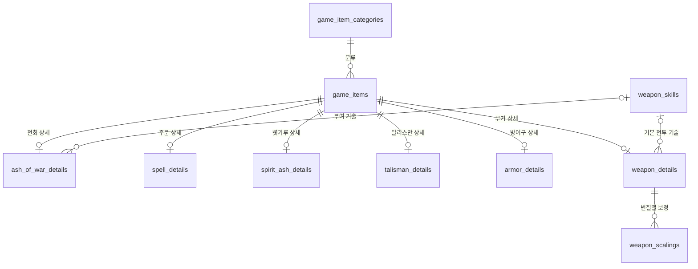

# 데이터베이스 설계

## 문서의 역할과 작성 범위

이 문서는 **현재 DB의 구조·데이터 의미·공통 저장 규칙을 설명하는 설계 명세**입니다. 특정 장비의 등록 기록이나 작업 이력을 모으는 문서가 아닙니다. 작성 목적은 다음 작업자가 어떤 테이블에 어떤 의미의 값을 저장하고, 어떤 관계·제약·권한을 지켜야 하는지 판단할 수 있게 하는 것입니다.

### 포함하는 내용

- 테이블·컬럼·enum·자료형·NULL 허용 여부·기본값·키·관계·제약·인덱스·권한.
- 필드의 의미와 공통 저장 기준. 예: `0`·`NULL`·보정 없음의 차이, 공격력·가드·상태 이상의 기준, 콘텐츠 소속과 획득 장소의 구분.
- 도메인 전반에 적용하는 등록·정렬 규칙과 출처 선택 원칙. 개별 자료의 채택 내역 대신 일반화된 규칙과 상세 문서 링크만 둡니다.
- 시드 파일의 역할·실행 순서·기존 행 처리 방식 등 재현에 필요한 실행 구조. 구체적인 파일 목록과 값은 `supabase/config.toml` 및 SQL을 기준으로 합니다.
- 구현된 구조의 한계와 미구현 범위, 현재 설계를 이해하는 데 필요한 결정 이유. 지난 논의나 구현 과정을 순서대로 나열하지 않습니다.
- 구조와 의미를 이해하는 데 꼭 필요한 최소 예시. 예시가 개별 장비의 전체 수치표·출처 기록으로 커지면 별도 문서로 분리합니다.

### 포함하지 않는 내용과 기록 위치

| 내용                                                                    | 기록 위치                                                                 |
| ----------------------------------------------------------------------- | ------------------------------------------------------------------------- |
| 실제 장비명·수치·설명·분류 목록·등록 순서                               | 시드 SQL 또는 실제 DB                                                     |
| 개별 장비의 출처 URL·추출 방법·값 변환·출처 충돌·사용자 확인 내역       | [DATA_SOURCES.md](DATA_SOURCES.md)                                        |
| 미확인 필드·확인 대상·인게임 확인 조건·확인 후 반영 기록                | [DATA_VERIFICATION.md](DATA_VERIFICATION.md)                              |
| 등록 건수·등록 완료 목록·이번 작업의 검증 결과·로컬 또는 운영 반영 보고 | 작업 완료 보고. 계속 참조할 데이터 등록 기록만 별도 출처·등록 문서에 보관 |
| 과거 개발 샘플의 이름·수치·자료·검증 이력                               | 현재 설계에 필요한 근거만 남기고 불필요한 기록은 삭제                     |
| 화면 구성·컴포넌트 배치·프론트엔드 표현 방식                            | [ARCHITECTURE.md](ARCHITECTURE.md)와 관련 UI 코드                         |

### 수정 여부 판단과 유지 원칙

1. **스키마나 공통 저장 규칙이 달라졌을 때만** 해당 설명을 수정합니다. 새 장비 등록·개별 수치 수정·이미지 추가만으로 이 문서에 절을 추가하지 않습니다.
2. 추가하려는 문장이 “데이터를 어떻게 저장하는가”를 설명하면 이 문서에 두고, “어떤 장비에 무엇을 넣었는가”를 설명하면 시드 또는 별도 출처·등록 문서에 둡니다.
3. 공통 기준과 개별 사례가 섞이면 공통 기준만 추출해 이 문서에 남기고 상세 사례로 연결합니다. 같은 내용을 여러 문서에 복사하지 않습니다.
4. SQL·설정·등록 목록을 문서에 그대로 복제하지 않습니다. 값이나 파일 목록을 열거해야만 유지되는 설명 대신 기준이 되는 파일과 역할을 안내합니다.
5. 새 결정은 관련 기존 항목에 통합합니다. 문서 끝에 날짜별 작업 기록이나 장비별 설명을 계속 덧붙이지 않습니다.
6. 변경 후 포함·제외 기준, SQL·설정과의 정합성, 링크를 확인합니다. 기존 문서에 범위 밖 내용이 있다는 이유로 같은 종류의 내용을 더 추가하지 않습니다.

## 기준 자료

| 확인 대상                       | 기준 자료                                        |
| ------------------------------- | ------------------------------------------------ |
| 테이블·컬럼·DB 제약·권한        | `supabase/migrations/*.sql`을 적용 순서대로 확인 |
| 실제 초기 입력 값               | `supabase/seed.sql`, `supabase/seeds/`의 SQL     |
| 로컬 서비스·시드 실행 설정      | `supabase/config.toml`                           |
| 설계 의도·값의 의미·미구현 범위 | 이 문서                                          |
| 특정 환경의 적용 여부·현재 행   | 해당 DB의 마이그레이션 이력과 실제 조회          |

문서와 SQL이 다르면 SQL로 구현 상태를 확인하고 차이를 명시합니다. 이 문서만으로 운영 반영 여부나 현재 데이터 전체를 판단하지 않습니다. 구조·공통 기준의 변경은 해당 항목에 통합하고, 데이터만 바뀌면 시드와 관련 출처·확인 문서만 갱신합니다.

개발 환경은 Docker 로컬 Supabase, 운영 환경은 Supabase 클라우드로 분리합니다.

## 명칭 기준

- 도감 UI·경로는 `catalog`, 개별 게임 아이템과 API 도메인은 `gameItem`을 사용합니다.
- DB에서는 snake_case로 `game_items`, `game_item_categories`, `game_item_type`, `game_item_id`를 사용합니다.
- `20261102011418_rename_game_item_domain.sql`에서 기존 이름을 변경합니다. 이전 마이그레이션은 당시 이름을 유지합니다.
- API 응답은 `gameItems`, `gameItemCategories`, `gameItemId`로 명시적으로 변환합니다.

## 개발 전에 확인할 확정 규칙

- 공통 아이템 식별자는 `game_items.id`입니다. 이름에는 고유 제약이 없으므로 기능에서 이름을 식별자로 사용하지 않습니다.
- `type`은 무기·주문 등의 종류, `category_id`는 단검·마술 등의 세부 분류입니다. 두 종류가 일치해야 한다는 규칙은 복합 외래키로 보장합니다.
- 이미지·콘텐츠 소속·게임 내 설명은 공통 정보입니다. 일반 설명은 제외했습니다. 게임 내 원문과 사용자 해설을 같은 컬럼에 섞지 않습니다.
- `content_code`는 콘텐츠 소속이며 판매 에디션·현재 소유 여부·획득 장소를 뜻하지 않습니다.
- 무기는 기본 전투 기술을 참조합니다. 전회 아이템과 전투 기술을 동일한 데이터로 취급하지 않습니다. 사용자의 전회 장착 상태는 저장하지 않습니다.
- 공격력·가드 성능은 표준 변질(변질 불가 무기는 기본 상태)의 최대 강화 기준, 변질별 보정은 각 변질의 최대 강화 기준, 부가 효과는 미강화 기본 수치입니다. 공격력은 캐릭터 능력치로 더해지는 공격력과 일시적 버프를 제외한 무기 자체 수치이고, 부가 효과도 캐릭터 능력치 보정·일시적 버프를 제외합니다. 이들을 동일한 조건의 수치로 계산하지 않습니다.
- 강화 단계 컬럼은 의도적으로 제외했습니다. `weapon_scalings`의 변질 선택에 맞춰 `weapon_details`의 공격력이 바뀐다고 가정하지 않습니다.
- 분류와 아이템의 `sort_order`는 등록 시 명시하는 양의 정수입니다. 분류는 같은 종류 안에서, 아이템은 같은 분류 안에서 작은 값부터 표시합니다. ID와 입력 순서는 표시 순서가 아닙니다.
- 장비별 출처 선택·보완·충돌 해결 근거는 [데이터 출처와 등록 기준](DATA_SOURCES.md)에서 관리합니다.
- 수치의 `0`과 `NULL`, 보정 등급의 `-`와 `NULL`은 구분합니다. 사용자 입력 기준에 따라 자료 표에 수면·발광 항목이 없으면 해당 축적 수치는 없음(`0`)으로 저장합니다. 그 외 미확인 값을 임의로 0이나 보정 없음으로 변환하지 않습니다.
- 인게임 확인이 필요한 미확인 정보는 [데이터 확인 목록](DATA_VERIFICATION.md)에 기록하고, 확인 후 DB·시드와 함께 갱신합니다.
- 공격 속성 배열은 출력 시 정렬합니다. 구체적인 표시 순서는 미확정이며 배열 저장 순서를 표시 규칙으로 삼지 않습니다.
- 모든 현재 테이블은 공개 조회용입니다. 로그인만으로 수정 권한이 생기지 않습니다. 쓰기·댓글·비공개 콘텐츠 기능은 별도 설계가 필요합니다.

## 테이블 관계



- 모든 획득 대상은 `game_items`에 저장하고, 종류별 정보는 상세 테이블로 분리합니다.
- 현재 상세 테이블은 무기·방어구·탈리스만·주문·전회를 구현했습니다. `game_items` 행만 있고 무기 상세가 없는 상태도 허용합니다.
- 무기는 기본 전투 기술 하나를 선택적으로 참조합니다. 여러 무기가 같은 기술을 참조할 수 있습니다.
- 전회는 획득 아이템이고 전투 기술은 발동하는 기술입니다. 전회는 `ash_of_war_details.skill_id`로 부여하는 기술을 참조합니다.
- 외래키는 모두 `ON UPDATE RESTRICT`, `ON DELETE RESTRICT`입니다. 참조 중인 키의 변경·삭제를 막으며 자동 연쇄 삭제는 하지 않습니다.

## 공통 종류: `game_item_type`

`game_items`, `game_item_categories`, `weapon_details`, `armor_details`에서 사용하는 PostgreSQL enum입니다.
이 문서의 코드 대응은 현재 스키마와 합의한 한국어 명칭을 기준으로 합니다. 모든 용어를 공식 현지화 자료와 별도 대조했다는 의미는 아닙니다.

| 값             | 의미        |
| -------------- | ----------- |
| `weapon`       | 무기        |
| `other_weapon` | 기타 무기   |
| `armor`        | 방어구      |
| `talisman`     | 탈리스만    |
| `ash_of_war`   | 전회        |
| `sorcery`      | 마술        |
| `incantation`  | 기도        |
| `other`        | 아이템      |
| `crystal_tear` | 결정 물방울 |
| `spirit_ash`   | 뼛가루      |

`20261102015026_replace_gesture_type_with_other.sql`에서 미사용 `gesture` 값을 `other`로 교체합니다. 표시명은 아이템이며 DB 키 `other`는 유지합니다. 도구·소모품·재료 등 세부 분류는 실제 등록 시 정의합니다.

- 기타 무기는 기존 `weapon_details`·`weapon_scalings`를 사용합니다. 지팡이와 성인은 기타 무기의 첫 두 카테고리입니다. 상세 등록 시 `type`을 부모와 동일하게 명시해야 합니다. 사거리·시전 보정 같은 전용 필드와 화면은 아직 구현하지 않았습니다.

## `game_item_categories`: 세부 분류

직검·단검·투구처럼 각 종류 안의 세부 분류를 관리합니다. 분류는 실제 아이템을 입력할 때 추가할 수 있습니다.

| 컬럼         | 자료형           | NULL 허용 | 의미                                                 |
| ------------ | ---------------- | --------- | ---------------------------------------------------- |
| `id`         | `bigint`         | 아니요    | 자동 생성 기본키                                     |
| `name`       | `text`           | 아니요    | 분류명. 빈 문자열·공백만 있는 값 금지                |
| `type`       | `game_item_type` | 아니요    | 분류가 속한 종류                                     |
| `sort_order` | `integer`        | 아니요    | 같은 종류 안의 표시 순서. 1 이상의 정수, 기본값 없음 |

- `(type, name)`은 고유합니다. 같은 종류에 같은 분류명을 중복 등록할 수 없습니다.
- `(id, type)` 고유 제약은 아이템에서 ID와 종류를 함께 참조하기 위해 사용합니다.

## `game_items`: 획득 대상의 공통 정보

| 컬럼                 | 자료형           | NULL 허용 | 의미                                                        |
| -------------------- | ---------------- | --------- | ----------------------------------------------------------- |
| `id`                 | `bigint`         | 아니요    | 자동 생성 기본키                                            |
| `name`               | `text`           | 아니요    | 아이템 이름. 빈 문자열·공백만 있는 값 금지                  |
| `type`               | `game_item_type` | 아니요    | 획득 대상의 종류                                            |
| `category_id`        | `bigint`         | 아니요    | 세부 분류 ID                                                |
| `sort_order`         | `integer`        | 아니요    | 같은 분류 안의 표시 순서. 1 이상의 정수, 기본값 없음        |
| `image_url`          | `text`           | 예        | 이미지 주소. URL 형식·접근 가능 여부는 DB에서 검증하지 않음 |
| `content_code`       | `text`           | 아니요    | 콘텐츠 소속. 아래 세 값만 허용하며 기본값 없음              |
| `game_description`   | `text`           | 예        | 게임 내 설명 원문                                           |
| `effect_description` | `text`           | 예        | 아이템 부가 효과의 표시용 설명                              |

| `content_code`          | 의미               |
| ----------------------- | ------------------ |
| `base_game`             | 본편               |
| `shadow_of_the_erdtree` | 황금 나무의 그림자 |
| `tarnished_pack`        | 빛바랜자 에디션    |

`tarnished_pack`은 사용자 결정에 따라 서비스에서 '빛바랜자 에디션'으로 표시합니다. 이는 서비스 표시명이며, 저장 값은 추가 콘텐츠 팩(Tarnished Pack)을 뜻합니다.
콘텐츠 소속과 실제 획득 장소·진행 조건은 구분합니다. 여러 콘텐츠를 묶은 판매 상품인 Tarnished Edition은 별도 값으로 두지 않습니다.
일반 해설·사용자 설명은 현재 저장하지 않습니다.
부가 효과는 `effect_description`에 설명으로만 저장합니다. NULL은 효과 없음 또는 미입력이며 구분하지 않습니다. 효과별 필터·계산용 구조는 두지 않습니다. 무기의 출혈·동상 등 축적 수치는 기존 전용 컬럼을 유지합니다.

- `(category_id, type)`이 `game_item_categories(id, type)`을 참조합니다. 무기에 방어구 분류를 연결할 수 없습니다.
- `(id, type)`은 무기 상세의 복합 외래키를 위한 고유 제약입니다.
- 아이템 이름에는 고유 제약이 없습니다. 이름이 아닌 ID가 식별 기준입니다.
- `(category_id, type)` 인덱스가 있습니다.

## 도감 표시 순서

- 분류 목록은 `type → sort_order → id` 순으로 조회하고, 화면에서 현재 종류만 표시합니다.
- 아이템은 `분류 sort_order → category_id → 아이템 sort_order → 아이템 id` 순으로 DB에서 정렬합니다. 도감은 종류를 필수 조건으로 조회하며, 개별 분류 선택 시 분류 조건을 추가합니다. 전체 보기와 개별 분류 조회에 같은 정렬 기준을 사용합니다.
- 순서 중복은 허용합니다. 분류 순서가 같으면 분류 ID로 그룹을 유지하고, 같은 분류 안의 아이템 순서가 같으면 아이템 ID로 순서를 확정합니다.
- 등록할 때 `sort_order`를 반드시 지정합니다. 간격을 둔 값(예: 10, 20, 30)도 가능하며, 순서 변경은 해당 값의 수정으로 처리합니다. 관리 화면과 쓰기 API는 아직 구현하지 않았습니다.
- `20261103061915_add_catalog_sort_order.sql`은 기존 데이터가 있는 환경에서 분류는 기존 이름순, 아이템은 분류 내 ID순으로 초기 값을 채웁니다. 새 순서 기준 적용 후에는 전체 아이템이 분류별로 모입니다.
- 분류 인덱스 `(type, sort_order, id)`, 아이템 인덱스 `(category_id, sort_order, id)`가 있습니다.

## `weapon_skills`: 전투 기술

| 컬럼           | 자료형   | NULL 허용 | 의미                                                                |
| -------------- | -------- | --------- | ------------------------------------------------------------------- |
| `id`           | `bigint` | 아니요    | 자동 생성 기본키                                                    |
| `name`         | `text`   | 아니요    | 기술 이름. 빈 문자열·공백만 있는 값 금지                            |
| `description`  | `text`   | 예        | 기술 설명                                                           |
| `fp_cost_text` | `text`   | 예        | FP 비용의 표시용 문자열. 복합 비용 표현을 위해 숫자로 제한하지 않음 |

이름에는 고유 제약이 없습니다. FP 문자열을 이용한 수치 계산·정렬 기능은 구현하지 않았습니다.

## `weapon_details`: 무기 상세

무기 하나당 최대 한 행을 저장합니다. 아래 표에서 키·종류 외 컬럼은 모두 NULL을 허용합니다.
수치의 `0`은 해당 수치·효과·요구 조건 없음, `NULL`은 미확인을 뜻합니다.

### 기본 특성

| 컬럼                    | 자료형           | 의미·제약                                                                                              |
| ----------------------- | ---------------- | ------------------------------------------------------------------------------------------------------ |
| `game_item_id`          | `bigint`         | 기본키. 아래 `type`과 함께 `game_items(id, type)` 참조                                                 |
| `type`                  | `game_item_type` | 기본값 `weapon`, NULL 불가. `weapon`·`other_weapon`만 허용. 부모 아이템과 타입 일치 필수               |
| `weight`                | `numeric`        | 중량, 0 이상                                                                                           |
| `can_change_affinity`   | `boolean`        | `true`: 변질 가능, `false`: 변질 불가, NULL: 미확인. 기본값 없음                                       |
| `physical_attack_types` | `text[]`         | 물리 공격 방식 목록. 아래 값만 허용하며 배열 내부 NULL 금지                                            |
| `upgrade_material`      | `text`           | `smithing_stone`(단석), `somber_smithing_stone`(색 잃은 단석), `none`(강화 불가)만 허용. NULL은 미확인 |
| `default_skill_id`      | `bigint`         | 기본 전투 기술. `weapon_skills.id` 참조                                                                |

| `physical_attack_types` 요소 | 게임 용어 |
| ---------------------------- | --------- |
| `standard`                   | 표준      |
| `slash`                      | 참격      |
| `strike`                     | 타격      |
| `pierce`                     | 관통      |

이 목록은 물리 공격 방식입니다. 공격력의 물리·마력·화염 등과는 다른 분류입니다.

| `upgrade_material`      | 게임 용어    |
| ----------------------- | ------------ |
| `smithing_stone`        | 단석         |
| `somber_smithing_stone` | 색 잃은 단석 |
| `none`                  | 강화 불가    |
| NULL                    | 미확인       |

저장 순서에 의미를 두지 않고 출력 시 정렬하는 방침입니다. 표시 순서와 정렬 코드는 아직 구현하지 않았습니다.
이 정렬 방침은 `physical_attack_types`에 적용합니다. 현재 DB는 빈 배열·중복 요소를 차단하지 않습니다.

### 공격력·가드 성능

**표준 변질의 최대 강화 기준**이며 캐릭터 능력치로 더해지는 공격력과 일시적 버프는 제외한 무기 자체 수치입니다. 가드 성능도 같은 무기 상태를 기준으로 합니다. 변질 불가 무기는 **기본 상태의 최대 강화 기준**입니다. 변질별·강화 단계별 수치를 저장하는 구조가 아니며, `max_upgrade_level` 컬럼은 두지 않았습니다.

| 컬럼               | 자료형    | 의미                   |
| ------------------ | --------- | ---------------------- |
| `attack_physical`  | `integer` | 물리 공격력            |
| `attack_magic`     | `integer` | 마력 공격력            |
| `attack_fire`      | `integer` | 화염 공격력            |
| `attack_lightning` | `integer` | 벼락 공격력            |
| `attack_holy`      | `integer` | 신성 공격력            |
| `critical`         | `integer` | 치명                   |
| `guard_physical`   | `numeric` | 물리 가드 시 감소율(%) |
| `guard_magic`      | `numeric` | 마력 가드 시 감소율(%) |
| `guard_fire`       | `numeric` | 화염 가드 시 감소율(%) |
| `guard_lightning`  | `numeric` | 벼락 가드 시 감소율(%) |
| `guard_holy`       | `numeric` | 신성 가드 시 감소율(%) |
| `guard_boost`      | `integer` | 가드 강도              |

정수는 0 이상, 가드 감소율은 0~100 범위만 허용합니다.

### 부가 효과·필요 능력치

부가 효과는 **미강화·기본 상태**이며 캐릭터 능력치 보정과 일시적 버프를 제외합니다. 최대 강화 공격력과 기준이 다릅니다. 모든 컬럼은 `integer`, 0 이상입니다.

| 컬럼                    | 의미                |
| ----------------------- | ------------------- |
| `scarlet_rot`           | 붉은 부패 축적 수치 |
| `frostbite`             | 동상 축적 수치      |
| `bleed`                 | 출혈 축적 수치      |
| `poison`                | 독 축적 수치        |
| `sleep`                 | 수면 축적 수치      |
| `madness`               | 발광 축적 수치      |
| `required_strength`     | 필요 근력           |
| `required_dexterity`    | 필요 기량           |
| `required_intelligence` | 필요 지력           |
| `required_faith`        | 필요 신앙           |
| `required_arcane`       | 필요 신비           |

`default_skill_id` 인덱스가 있습니다.

## `weapon_scalings`: 변질별 능력 보정

**최대 강화 기준**으로 지원하는 변질의 행만 등록합니다. 변질 불가 무기는 기본 상태를 `standard` 한 행으로 저장하고, 화면에서 표준 변질 가능으로 해석하지 않습니다. 변질 가능 여부는 `weapon_details.can_change_affinity`로 확인합니다. 이 행 구성 규칙은 입력 규칙이며, 현재 DB가 변질 가능 여부와 보정 행의 조합을 강제하지는 않습니다.

| 컬럼           | 자료형   | NULL 허용 | 의미                               |
| -------------- | -------- | --------- | ---------------------------------- |
| `game_item_id` | `bigint` | 아니요    | `weapon_details.game_item_id` 참조 |
| `affinity`     | `text`   | 아니요    | 변질 종류                          |
| `strength`     | `text`   | 예        | 근력 보정                          |
| `dexterity`    | `text`   | 예        | 기량 보정                          |
| `intelligence` | `text`   | 예        | 지력 보정                          |
| `faith`        | `text`   | 예        | 신앙 보정                          |
| `arcane`       | `text`   | 예        | 신비 보정                          |

- `(game_item_id, affinity)`가 복합 기본키입니다. 동일 무기·변질 중복을 막습니다.
- 보정 값은 `S`, `A`, `B`, `C`, `D`, `E`, `-`만 허용합니다. `-`는 보정 없음, NULL은 미확인입니다.
- 등급을 비교·정렬할 때는 `S > A > B > C > D > E` 순서입니다. 문자열 사전순으로 정렬하지 않습니다. `-`와 NULL은 등급이 아닙니다.
- 모든 무기에 13행을 요구하지 않습니다. 행이 없는 이유(미입력·지원 안 함)는 현재 스키마만으로 구분하지 않습니다.

| 값          | 변질   |
| ----------- | ------ |
| `standard`  | 표준   |
| `heavy`     | 중후   |
| `keen`      | 예리   |
| `quality`   | 상질   |
| `fire`      | 화염   |
| `flame_art` | 화염술 |
| `lightning` | 벼락   |
| `sacred`    | 신성   |
| `magic`     | 마력   |
| `cold`      | 냉기   |
| `poison`    | 독     |
| `blood`     | 피     |
| `occult`    | 신비   |

### 이름이 같아도 구분해야 하는 용어

| 저장 위치                        | 값·컬럼    | 의미                  |
| -------------------------------- | ---------- | --------------------- |
| `physical_attack_types`          | `standard` | 물리 공격 방식인 표준 |
| `weapon_scalings.affinity`       | `standard` | 표준 변질             |
| `weapon_scalings.affinity`       | `occult`   | 신비 변질             |
| `weapon_scalings.arcane`         | 보정 등급  | 신비 능력치의 보정    |
| `weapon_details.required_arcane` | 요구 수치  | 필요 신비             |
| `weapon_details.attack_magic`    | 공격력     | 마력 공격력           |
| `weapon_scalings.affinity`       | `magic`    | 마력 변질             |
| `weapon_scalings.intelligence`   | 보정 등급  | 지력 능력치의 보정    |
| `weapon_details.poison`          | 축적 수치  | 기본 독 부가 효과     |
| `weapon_scalings.affinity`       | `poison`   | 독 변질               |

`required_`는 필요 능력치를 표현하기 위한 DB 접두사입니다. 화면에서는 근력·기량·지력·신앙·신비와 '필요 능력치'라는 문맥으로 표시합니다.
분류명과 아이템·기술 이름은 코드 enum이 아니라 `name`에 한국어 문자열로 저장합니다. ID의 숫자를 게임 용어나 고정 코드처럼 사용하지 않습니다.

## 공개 접근

모든 테이블에 RLS를 활성화했습니다. `anon`·`authenticated` 역할에는 SELECT 권한과 전체 행 조회 정책만 부여합니다.
일반 클라이언트의 INSERT·UPDATE·DELETE 권한은 제거했습니다. 현재 비공개·검수 상태 구분은 없으므로 등록된 행은 모두 공개 조회 대상입니다.
로컬 시드 입력은 일반 클라이언트가 아닌 DB 관리자 권한으로 수행합니다.

## 무기 상세 조회

무기 하나의 상세 화면을 조회할 때 기준 행은 `game_items`입니다. 분류·무기 상세·기본 전투 기술을 연결하고, 변질별 보정은 여러 행의 목록으로 가져옵니다. 상세와 기술 연결이 선택 사항이므로 목록에서 무조건 내부 조인하면 상세 미입력 아이템이 빠질 수 있습니다.

예를 들어 다음은 공통 정보와 기본 기술을 조회하는 읽기 전용 SQL입니다. `$1`은 조회할 아이템 ID를 받는 바인딩 매개변수이며, SQL Editor에서 그대로 실행할 때는 실제 ID로 바꿉니다.

```sql
select
  i.id, i.name, i.type, i.image_url, i.content_code, i.game_description,
  c.name as category_name,
  d.weight, d.attack_physical,
  s.name as skill_name, s.description as skill_description, s.fp_cost_text
from public.game_items i
join public.game_item_categories c on c.id = i.category_id
left join public.weapon_details d on d.game_item_id = i.id
left join public.weapon_skills s on s.id = d.default_skill_id
where i.id = $1;
```

변질별 보정은 `weapon_scalings.game_item_id`로 조회합니다. 단순 조인하면 보정 행 수만큼 공통 아이템 정보도 반복되므로, 조회 결과를 각각 별도 아이템으로 취급하지 않습니다. 변질의 화면 표시 순서도 별도로 정해야 합니다.

## 마이그레이션·시드

- `supabase/migrations/`: 구조 변경 이력. 적용된 파일을 수정하지 않고 새 파일을 추가합니다.
- `supabase/seed.sql`: 도감 분류를 등록합니다. 기존 분류는 건너뛰어 변경된 표시 순서를 덮어쓰지 않습니다.
- `supabase/seeds/`: 종류·분류별 아이템과 상세 데이터를 등록합니다. 기존 행 건너뛰기·NULL 보완 등 갱신 정책은 각 SQL에서 확인합니다. 시드 파일만 수정한다고 기존 DB 값이 모두 갱신되지는 않습니다.
- `supabase/config.toml`의 `sql_paths`가 실행 파일과 순서를 정합니다. 분류 등록 후 관련 아이템 시드를 실행합니다.
- 로컬 DB 초기화 시 마이그레이션 이후 시드가 실행됩니다. 일부 분류는 마이그레이션에서도 등록하므로 전체 DB 재생성 시 다시 생길 수 있습니다. 초기화는 데이터를 삭제하므로 단순 데이터 추가에 사용하지 않습니다.
- 자료별 추출·변환·기존 값 보존 기준은 [데이터 출처와 등록 기준](DATA_SOURCES.md)을 참고합니다.

## `armor_details`: 방어구 상세

개별 방어구를 목록 단위로 사용하며 `game_item_categories`의 갑옷·투구·장갑·각반으로 분류합니다.
세트와 경갑·중갑 등의 분류는 현재 저장하지 않습니다. 추후 부위 분류를 유지하면서 별도 관계나 필드로 확장합니다.

| 컬럼                 | 자료형           | 의미                                              |
| -------------------- | ---------------- | ------------------------------------------------- |
| `game_item_id`       | `bigint`         | 기본키. `type`과 함께 `game_items(id, type)` 참조 |
| `type`               | `game_item_type` | NULL 불가, 기본값 `armor`, `armor`만 허용         |
| `weight`             | `numeric`        | 중량, 0 이상                                      |
| `negation_physical`  | `numeric`        | 물리 경감률                                       |
| `negation_strike`    | `numeric`        | 타격 경감률                                       |
| `negation_slash`     | `numeric`        | 참격 경감률                                       |
| `negation_pierce`    | `numeric`        | 관통 경감률                                       |
| `negation_magic`     | `numeric`        | 마력 경감률                                       |
| `negation_fire`      | `numeric`        | 화염 경감률                                       |
| `negation_lightning` | `numeric`        | 벼락 경감률                                       |
| `negation_holy`      | `numeric`        | 신성 경감률                                       |
| `immunity`           | `integer`        | 면역                                              |
| `robustness`         | `integer`        | 강건                                              |
| `focus`              | `integer`        | 이성                                              |
| `vitality`           | `integer`        | 항사                                              |
| `poise`              | `integer`        | 강인도                                            |

키·종류 외 모든 컬럼은 NULL을 허용합니다. 0은 실제 0, NULL은 미확인입니다.
관통 경감률은 음수를 허용하며 상한은 100입니다. 나머지 경감률은 0~100, 내성과 강인도는 0 이상입니다.
캐릭터 전체 능력치·버프 결과가 아닌 방어구 한 부위 자체의 표시 수치를 저장합니다.
공개 조회만 허용하며 쓰기 권한은 일반 클라이언트에 부여하지 않습니다.
네 부위 분류는 마이그레이션으로 등록합니다. 경장 등 변형은 별도 아이템이며 세트·원본과 변형 관계는 저장하지 않습니다.

## `talisman_details`: 탈리스만 상세

| 컬럼           | 자료형           | 의미                                              |
| -------------- | ---------------- | ------------------------------------------------- |
| `game_item_id` | `bigint`         | 기본키. `type`과 함께 `game_items(id, type)` 참조 |
| `type`         | `game_item_type` | NULL 불가, 기본값 `talisman`, `talisman`만 허용   |
| `weight`       | `numeric`        | NULL 허용, 0 이상. 0은 실제 0, NULL은 미확인      |

- 탈리스만은 기존 표시 순서의 연속 구간을 세부 분류로 사용합니다. 분류를 나누기 전과 같은 순서로 전체 목록을 표시합니다.
- 이름·이미지·콘텐츠 소속·원문·효과 설명은 공통 `game_items`에 저장합니다. 효과는 설명으로만 제공하고 계산·필터용 구조는 두지 않습니다.
- +1·+2 등의 변형은 별도 아이템으로 등록합니다. 변형 연결·동시 장착 제한·사용자 장착 상태는 현재 저장하지 않습니다.
- 외래키는 UPDATE·DELETE RESTRICT이며, RLS와 공개 SELECT만 허용하는 정책을 따릅니다.

## `spirit_ash_details` 뼛가루 상세

- `game_item_id`를 기본키로 사용하며 `type = 'spirit_ash'`와 함께 `game_items(id, type)`을 참조합니다.
- `fp_cost`와 `hp_cost`는 소환에 드는 FP·HP의 0 이상 정수입니다. 두 값이 0이면 비용 없음이며, 상세 행이 없으면 미확인으로 표시합니다.
- RLS를 활성화하고 `anon`과 `authenticated`에 공개 조회만 허용합니다.

## `spell_details`: 주문 상세

마술과 기도는 각각 `sorcery`, `incantation` 타입을 사용하며 같은 주문 상세 테이블을 참조합니다.
마술과 기도 계통은 `game_item_categories`에 저장합니다. 요구 능력치로 분류를 추론하지 않습니다.

| 컬럼                    | 자료형           | 의미                                                             |
| ----------------------- | ---------------- | ---------------------------------------------------------------- |
| `game_item_id`          | `bigint`         | 기본키. `type`과 함께 `game_items(id, type)` 참조                |
| `type`                  | `game_item_type` | NULL 불가. `sorcery`·`incantation`만 허용하며 부모 아이템과 일치 |
| `fp_cost_text`          | `text`           | 소비 FP 표시용 문자열. 수치 정렬·계산에는 사용하지 않음          |
| `slots_used`            | `integer`        | 사용 슬롯, 1 이상                                                |
| `required_intelligence` | `integer`        | 필요 지력, 0 이상                                                |
| `required_faith`        | `integer`        | 필요 신앙, 0 이상                                                |
| `required_arcane`       | `integer`        | 필요 신비, 0 이상                                                |

- 키·종류 외 모든 컬럼은 NULL을 허용합니다. 필요 능력치의 0은 요구 없음, NULL은 미확인입니다.
- FP는 버프·장비에 의한 소비량 변경을 제외한 주문 자체의 표시 정보입니다. 추가·지속 비용은 확인한 표현을 문자열로 보존합니다.
- 이름·이미지·콘텐츠 소속·게임 내 설명 원문·효과 설명은 공통 `game_items`에 저장합니다.
- 스태미나·차지 여부·연속 시전·계통·공격력·회복량·지속 시간의 전용 컬럼과 사용자 기억 상태는 두지 않습니다. 필요한 효과·조건은 설명으로 제공합니다.
- 외래키는 UPDATE·DELETE RESTRICT이며 RLS와 공개 SELECT 정책을 따릅니다.
- 마술·기도 분류는 마이그레이션으로 등록합니다.

## `ash_of_war_details`: 전회 상세

획득 아이템인 전회와 발동 기술인 `weapon_skills`를 구분합니다. 전회 카테고리는 `game_item_categories`로 관리하며, 개별 전회의 기본 변질은 상세 필드에 저장합니다.

| 컬럼                        | 자료형           | 의미                                                          |
| --------------------------- | ---------------- | ------------------------------------------------------------- |
| `game_item_id`              | `bigint`         | 기본키. `type`과 함께 `game_items(id, type)` 참조             |
| `type`                      | `game_item_type` | NULL 불가, 기본값 `ash_of_war`, 이 값만 허용                  |
| `skill_id`                  | `bigint`         | 부여하는 기술. `weapon_skills.id` 참조, NULL은 미확인         |
| `native_affinity`           | `text`           | 표시되는 기본 변질. 기존 13종 변질 코드만 허용, NULL은 미확인 |
| `applicable_armaments_text` | `text`           | 적용 가능한 무기와 제외 조건 설명, NULL은 미확인              |

- 기술 이름·설명·소비 FP는 `weapon_skills`에서 재사용합니다. 전회에 중복 컬럼을 두지 않습니다.
- 전회 이름·이미지·콘텐츠 소속·게임 내 설명 원문은 공통 `game_items`에 저장합니다.
- 기본 변질은 선택 가능한 모든 변질이나 사용자 장착 상태를 의미하지 않습니다. 적용 대상 설명으로 실제 장착 가능 여부를 자동 판정하지 않습니다.
- 기본 장착 무기는 `weapon_details.default_skill_id`가 담당합니다. 파생 기술 관계·획득 방법·공략·평가·패치 이력은 이번 범위에서 저장하지 않습니다.
- 동명의 주문과 전투 기술은 별개입니다. 휘검의 원진과 거검진 역시 별개 기술로 유지합니다.
- 외래키는 UPDATE·DELETE RESTRICT이며, `skill_id` 인덱스와 RLS·공개 SELECT 정책을 사용합니다.

## 결정 물방울: `crystal_tear`

- 영약에 배합하는 결정 물방울을 `game_items.type = 'crystal_tear'`로 등록합니다. 일반 성배병 회복량 강화용 성배의 물방울은 포함하지 않습니다.
- `category_id`는 현재 필수이므로 기본 분류 결정 물방울 하나를 등록합니다. `game_item_categories`의 역할은 후속 검토 대상입니다.
- 이름·이미지·콘텐츠 소속·게임 내 원문·효과 설명은 `game_items` 공통 필드에 저장합니다. 전용 상세 테이블과 수치·지속 시간 전용 컬럼은 두지 않습니다.
- 영약의 성배병 자체와 사용자 배합 상태는 현재 등록하지 않습니다.
- 동일 물방울의 복수 획득 위치·보유 수량·동일 물방울 두 개 배합은 현재 모델링하지 않습니다.

## 아직 구현하지 않은 범위

- 그 밖의 종류의 상세 테이블, 일반 해설·댓글, 변질별 공격력, 강화 단계별 능력치는 구현하지 않았습니다.
- 전회 교체 가능 여부(`can_change_ash_of_war`)는 별도 필드로 두지 않습니다. `can_change_affinity`나 강화 재료로 대신 추론하지 않습니다.
- 촉매의 마술·기도 보정은 캐릭터 능력치에 따라 달라지는 수치이며 현재 `weapon_scalings`의 등급과는 다른 정보입니다. 전용 저장·표시 기준은 아직 설계하지 않았습니다.
